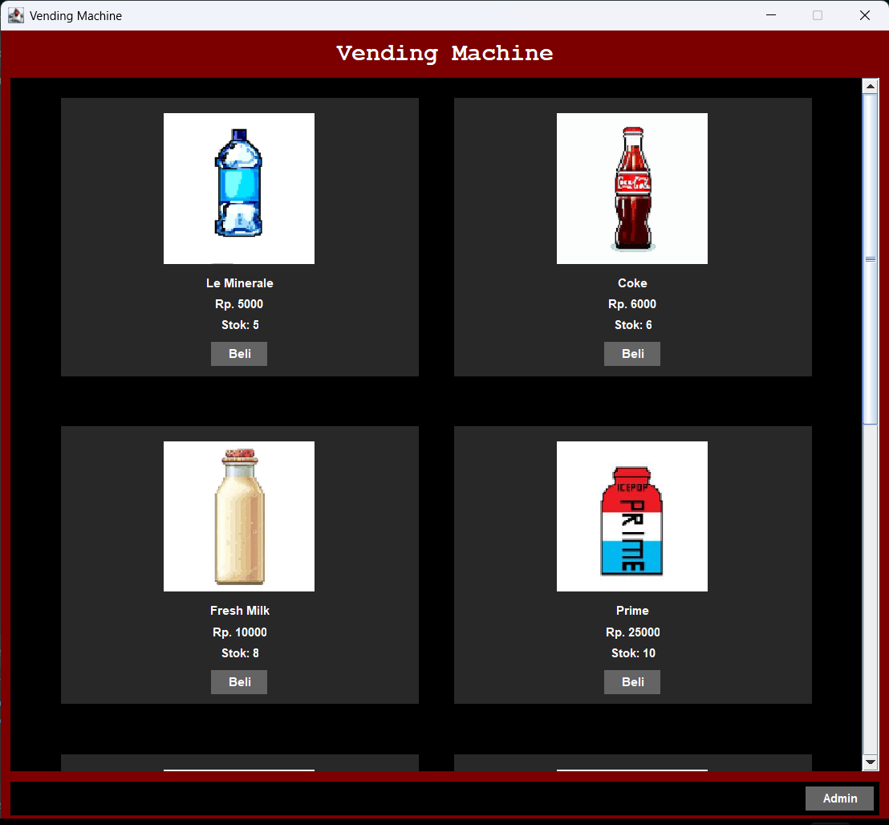
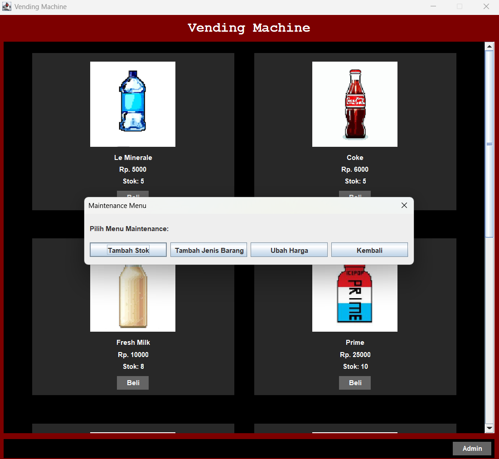
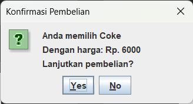

# Vending Machine GUI

A vending machine simulation built with Java Swing. Products appear as cards in a two-column grid, each one with a photo, price, stock count and a buy button. Buying an item asks for confirmation, lowers the stock by one and plays a short sound. A password-protected admin menu handles restocking, new products and price changes.

The program keeps everything in three `ArrayList` fields at the top of `VendingMachineGUI.java` (products, prices, stock). Nothing is written to disk, so closing the window resets the machine to its starting stock.

The interface text is in Indonesian ("Beli", "Stok", "Kembali").

## How to run

You need a JDK. Compile and run from the project folder:

```
javac VendingMachineGUI.java
java VendingMachineGUI
```

The image and sound paths are relative (`Assets\water.jpg`, `Assets\vmSound.wav`), so the `Images` folder has to be inside the folder you run the program from. Those backslashes also mean the code only runs on Windows as written. On Linux or macOS, change them to forward slashes first.

## What the program does

On startup the constructor loads the eight product photos, scales each one to 150x150 pixels and builds the card grid. A card shows the photo, the product name, the price in rupiah, the remaining stock and a `Beli` button. When stock reaches zero the button is disabled and turns dark red, so a sold out product looks different before anyone clicks it.

Clicking `Beli` opens a confirmation dialog with the product name and price. Confirming subtracts one from the stock, rebuilds the grid so the new count is visible, plays `vmSound.wav` and shows a thank-you message. Cancelling does nothing.

The `Admin` button at the bottom right asks for a password (currently `suki`). After a correct password the maintenance menu offers three actions: add stock to a product, add a completely new product, or change a price. Each action validates its input, rejects negative numbers and rebuilds the grid when it finishes. New products are added to the end of the lists and get `potion.png` as their picture.

## Five GUI components

The assignment asks for five components, and this program uses more than five. These are the five that carry the interface.

### JFrame (line 8)

`VendingMachineGUI` extends `JFrame`, so the class itself is the application window. The window settings sit in the constructor at lines 22 to 25.

```java
public class VendingMachineGUI extends JFrame {
    ...
    setTitle("Vending Machine");
    setDefaultCloseOperation(JFrame.EXIT_ON_CLOSE);
    setSize(900, 830);
    setResizable(false);
```

```java
add(mainPanel);
setLocationRelativeTo(null);
```

```java
SwingUtilities.invokeLater(() -> {
    VendingMachineGUI VM = new VendingMachineGUI();
    VM.setVisible(true);
});
```

The frame is what the operating system draws on screen, so without it there is no window at all. Extending `JFrame` instead of creating a separate `JFrame` object also means `this` can be passed to every dialog call in the file, which is why the pop-ups always appear centred over the machine and block input to it while open. `setDefaultCloseOperation` makes the X button end the process, and the fixed 900x830 size keeps the two-column grid from stretching into a layout that does not fit. The `main` method then builds the window on the event dispatch thread, which is the thread Swing expects for creating components.

### JPanel (lines 16, 17, 29, 38, 53, 107, 112 and 117)

Panels are the boxes everything else is placed into. The outer one uses `BorderLayout`, the product grid uses `GridLayout`, and each card uses `BoxLayout` to stack its contents vertically.

The two panels that live for the whole session are declared as fields, so the constructor assigns to them rather than declaring new variables.

```java
private JPanel mainPanel;
private JPanel productsPanel;
```

```java
mainPanel = new JPanel(new BorderLayout(10, 10));
mainPanel.setBackground(new Color(125, 0, 0));
mainPanel.setBorder(BorderFactory.createEmptyBorder(10, 10, 10, 10));
```

```java
productsPanel = new JPanel(new GridLayout(0, 2, 35, 50));
productsPanel.setBackground(new Color(0, 0, 0));
productsPanel.setBorder(BorderFactory.createEmptyBorder(20, 50, 100, 50));
```

The other panels are local variables created inside methods, so their type is written on the same line.

```java
JPanel productCard = new JPanel();
productCard.setLayout(new BoxLayout(productCard, BoxLayout.Y_AXIS));
productCard.setBackground(new Color(40, 40, 40));
```

```java
JPanel adminPanel = new JPanel(new FlowLayout(FlowLayout.RIGHT));
adminPanel.setBackground(Color.BLACK);
```

`BorderLayout` splits the window into a header on top, the scrollable grid in the middle and the admin row at the bottom. `GridLayout(0, 2, ...)` is what makes the cards line up in pairs with equal gaps no matter how many products exist. The nested panels matter most for updates: because each card is a panel inside `productsPanel`, `updateProductCards()` can call `productsPanel.removeAll()` and rebuild every card from the current list values. That is how a purchase or an admin change shows up on screen immediately, without restarting the program.

### JLabel (lines 33, 114, 121, 125 and 129)

Labels show text the customer reads but cannot edit.

```java
JLabel headerLabel = new JLabel("Vending Machine", SwingConstants.CENTER);
headerLabel.setFont(new Font("Courier New", Font.BOLD, 24));
headerLabel.setForeground(Color.WHITE);
```

```java
JLabel nameLabel = new JLabel(products.get(i), SwingConstants.CENTER);
JLabel priceLabel = new JLabel("Rp. " + harga.get(i), SwingConstants.CENTER);
JLabel stockLabel = new JLabel("Stok: " + stok.get(i), SwingConstants.CENTER);
```

Labels are also used to display the product photos (line 114: `imagePanel.add(new JLabel(productImages.get(i)))`), because an `ImageIcon` can be attached to a label directly.

The text on each label is built from the current list values at the moment the card is created, so it always matches the data behind it. Since labels cannot be typed into, price and stock stay read-only for customers and can only change through the admin dialogs. The white foreground on a dark card and the centred alignment are set one label at a time, so all eight cards end up with the same look.

### JButton (lines 18, 55 and 133)

Buttons trigger every action in the program. The admin button is a field because the constructor only sets it up once, while the buy buttons are created inside the loop in `updateProductCards()` and thrown away on each rebuild.

```java
private JButton adminButton;
```

```java
adminButton = new JButton("Admin");
styleButton(adminButton);
adminButton.addActionListener(e -> showAdminLogin());
```

```java
JButton buyButton = new JButton("Beli");
buyButton.setAlignmentX(Component.CENTER_ALIGNMENT);
styleButton(buyButton);
```

```java
final int index = i;
buyButton.addActionListener(e -> handlePurchase(index));

if (stok.get(i) == 0) {
    buyButton.setEnabled(false);
    buyButton.setBackground(new Color(100, 0, 0));
}
```

Each card gets its own buy button, and the loop index is copied into a `final` variable so the listener knows which product was clicked. One method, `handlePurchase(int index)`, therefore serves all products instead of needing a separate handler per item. Disabling the button when stock hits zero stops the purchase path before the dialog even opens, so a sold out product cannot be bought by accident. `styleButton()` removes the default border and focus outline, which is why the buttons look flat and match the dark theme.

### JScrollPane (line 42)

The grid of eight products is taller than the window, so it needs to scroll.

```java
JScrollPane scrollPane = new JScrollPane(productsPanel);
scrollPane.setVerticalScrollBarPolicy(JScrollPane.VERTICAL_SCROLLBAR_AS_NEEDED);
scrollPane.setHorizontalScrollBarPolicy(JScrollPane.HORIZONTAL_SCROLLBAR_NEVER);
scrollPane.getVerticalScrollBar().setUnitIncrement(20);
scrollPane.setBorder(null);
scrollPane.setBackground(new Color(0, 0, 0));
```

`JScrollPane` wraps `productsPanel` and gives it a vertical scrollbar only when the content is too tall. Without it, the last rows would be clipped and the bottom products would be unreachable. Turning the horizontal bar off keeps the two-column grid from shifting sideways, and the unit increment of 20 makes one wheel notch move further than the default, which suits an 830-pixel window. `setBorder(null)` removes the default bevel so the scroll area blends into the black background.

## Other components

`JOptionPane` handles every pop-up in the program: the sold out warning, the purchase confirmation, the admin password prompt, the maintenance menu, the add-stock and change-price pickers, and all the success and error messages. `JPasswordField` (line 197) and `JTextField` (lines 267 to 269) collect the admin's password and new product details. The purchase sound comes from `AudioSystem`, not from a Swing component (lines 163 to 172).

## Screenshots

<div align="center">
<p><b>Main window</b></p>
  
</div>

*The vending machine window at startup. Eight product cards with photo, name, price, stock and a Beli button, with the Admin button at the bottom right.*
<br><br>

<div align="center">
<p><b>Admin Maintenance Menu</b></p>
  
</div>

*The maintenance menu that appears after entering the admin password, offering Tambah Stok, Tambah Jenis Barang, Ubah Harga and Kembali.*
<br><br>

<div align="center">
<p><b>Purchase confirmation dialog</b></p>
  
</div>

*The confirmation dialog for a purchase, showing the product name, its price and the Yes / No buttons.*
